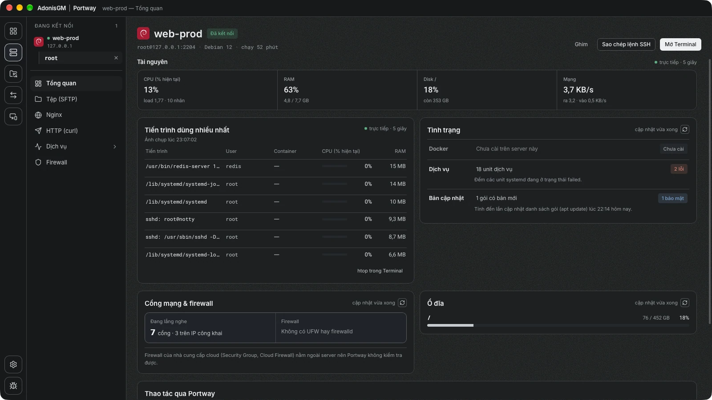
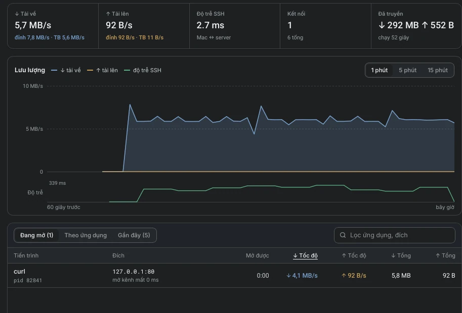
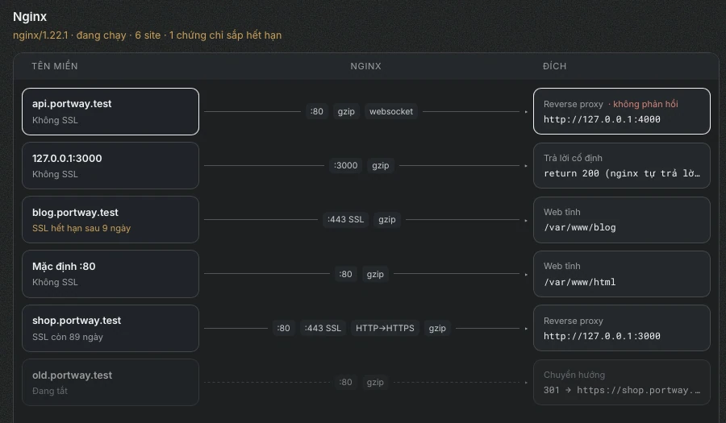
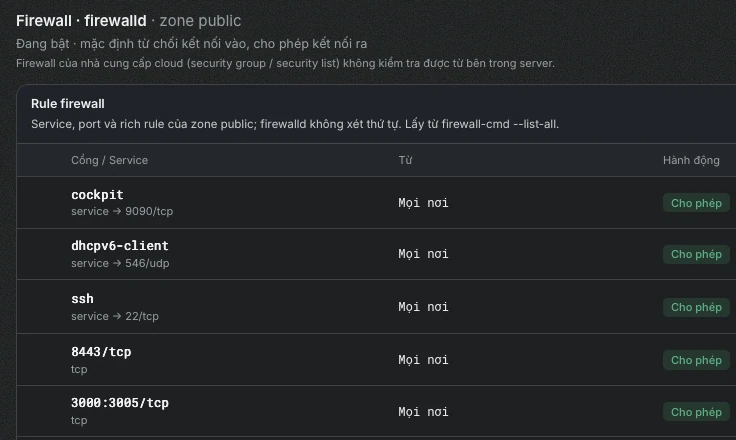
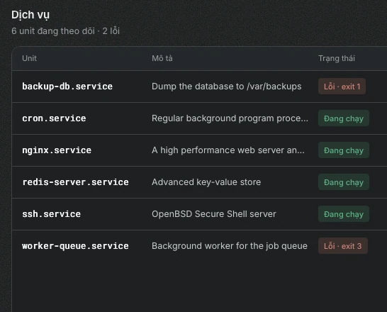

<div align="center">


# Portway

**Mọi server Linux, quản lý trong một cửa sổ.**

Ứng dụng desktop kết nối qua SSH, duyệt tệp, mở tunnel và quản trị dịch vụ trên nhiều server.
Không cài agent lên server, và mọi thay đổi Portway thực hiện đều được ghi vào nhật ký.

[Tải về](https://github.com/AdonisGM/Portway/releases) · [Trang chủ](https://portway.nmtung.dev/vi/) · [Tài liệu](https://portway.nmtung.dev/docs/vi/) · [English](https://portway.nmtung.dev/)




</div>

## Tính năng nổi bật

- **Nhiều server, nhiều tài khoản.** Nhóm và thẻ, nhập từ `~/.ssh/config`, jump host, kiểm tra khoá máy chủ như OpenSSH.
- **Tệp (SFTP).** Duyệt, kéo thả, sửa bằng ứng dụng trên máy và tự tải lại khi lưu, thao tác bằng quyền root qua `sudo`, theo dõi log kiểu `tail -f`.
- **Truyền tệp giữa hai máy.** Giao diện hai khung, sao chép từ server này sang server khác.
- **Tunnel.** Local, SOCKS5 và Remote, tự kết nối lại, màn hình theo dõi tốc độ và ứng dụng nào đang dùng tunnel.
- **Docker, systemd, Nginx, firewall.** Container, image, volume, dịch vụ, site Nginx kèm hạn chứng chỉ SSL, rule `ufw` / `firewalld` đối chiếu với cổng đang mở ra internet.
- **HTTP từ chính server.** Gửi request kiểu Postman từ server đang kết nối, xem thời gian từng giai đoạn.
- **Connect.** Hai Portway của cùng một người trong một mạng LAN ghép đôi một lần để gửi tệp, chia sẻ clipboard và đánh thức máy kia.
- **Nhật ký thao tác.** Mọi lệnh làm thay đổi server đều được ghi lại kèm kết quả.
- **Bảo mật.** Mật khẩu và khoá nằm trong Keychain (macOS) hoặc Credential Manager (Windows), mật khẩu `sudo` chỉ đi qua stdin.
- **Tiếng Việt và tiếng Anh**, giao diện sáng và tối.

## Giao diện

<table>
  <tr>
    <td width="50%"><br /><sub><b>Tunnel</b>: tốc độ, độ trễ và ứng dụng đang dùng</sub></td>
    <td width="50%"><br /><sub><b>Nginx</b>: từ tên miền tới đích, hạn chứng chỉ SSL</sub></td>
  </tr>
  <tr>
    <td><br /><sub><b>Firewall</b>: rule và cổng đang mở ra internet</sub></td>
    <td><br /><sub><b>Dịch vụ</b>: systemd, log và tệp unit</sub></td>
  </tr>
</table>

## Cài đặt

Tải bản cài cho macOS hoặc Windows ở trang [Releases](https://github.com/AdonisGM/Portway/releases). Hướng dẫn từng bước nằm ở [Cài đặt Portway](https://portway.nmtung.dev/docs/vi/getting-started/install/) và [Thêm server và kết nối](https://portway.nmtung.dev/docs/vi/getting-started/add-server/).

- **macOS** 11 trở lên, Apple Silicon hoặc Intel.
- **Windows** 10 (1809) trở lên, 64-bit.
- **Server đích**: Linux có OpenSSH. Các tính năng quản trị dùng công cụ sẵn có của server (`systemd`, `docker`, `nginx`, `ufw`, `firewalld`).

## Tài liệu

| | |
|---|---|
| [Bắt đầu](https://portway.nmtung.dev/docs/vi/getting-started/add-server/) | Thêm server và kết nối lần đầu |
| [Tệp](https://portway.nmtung.dev/docs/vi/files/browse/) | Duyệt, sửa, truyền tệp, quyền root |
| [Tunnel](https://portway.nmtung.dev/docs/vi/tunnels/create/) | Tạo và theo dõi tunnel |
| [Docker, dịch vụ, Nginx, Firewall](https://portway.nmtung.dev/docs/vi/docker/containers/) | Quản trị ứng dụng trên server |
| [Connect](https://portway.nmtung.dev/docs/vi/connect/overview/) | Ghép đôi hai máy trong mạng LAN |
| [Kiến trúc và bảo mật](https://portway.nmtung.dev/docs/vi/internals/security-and-data/) | Portway chạy lệnh gì và lưu dữ liệu ở đâu |

## Phát triển

Portway xây bằng [Tauri 2](https://tauri.app): giao diện React 19, phần SSH, SFTP và tunnel viết bằng Rust ([russh](https://github.com/Eugeny/russh)).

```sh
./scripts/dev.sh
```

Cần Node.js 24+, pnpm và Rust stable. Cách kiểm tra, server thử nghiệm bằng Docker, đóng gói, ký bản build và quy ước của dự án nằm ở [DEVELOPMENT.md](DEVELOPMENT.md).
